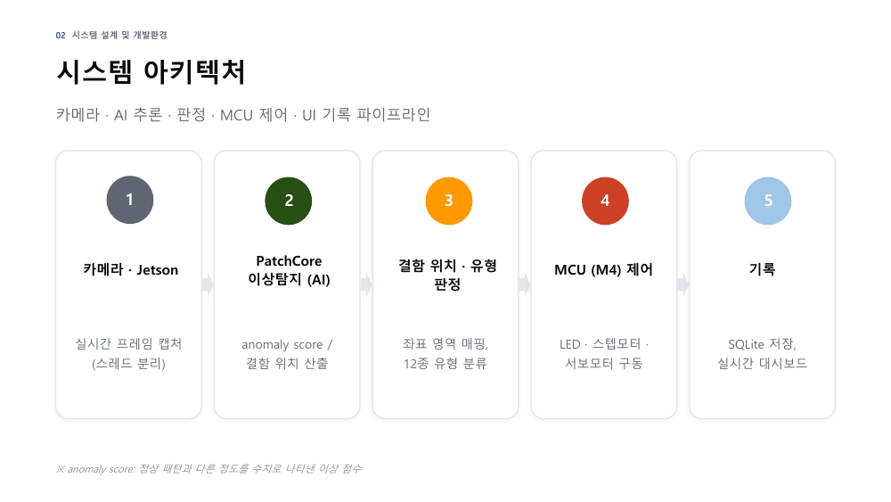
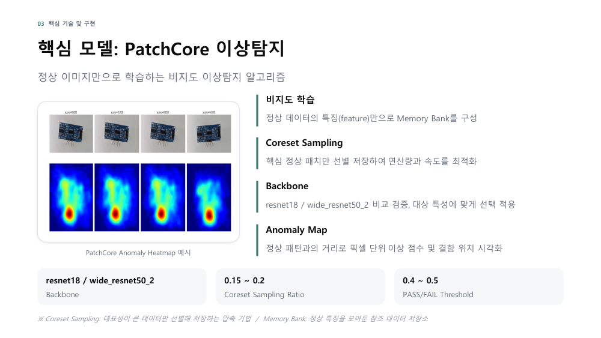
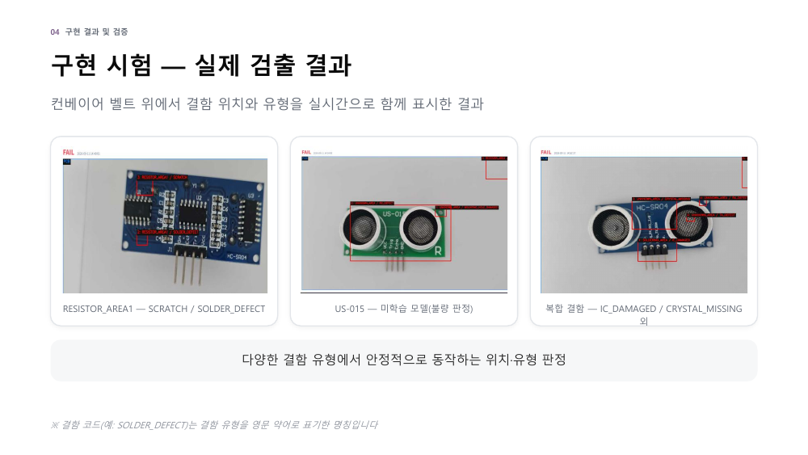
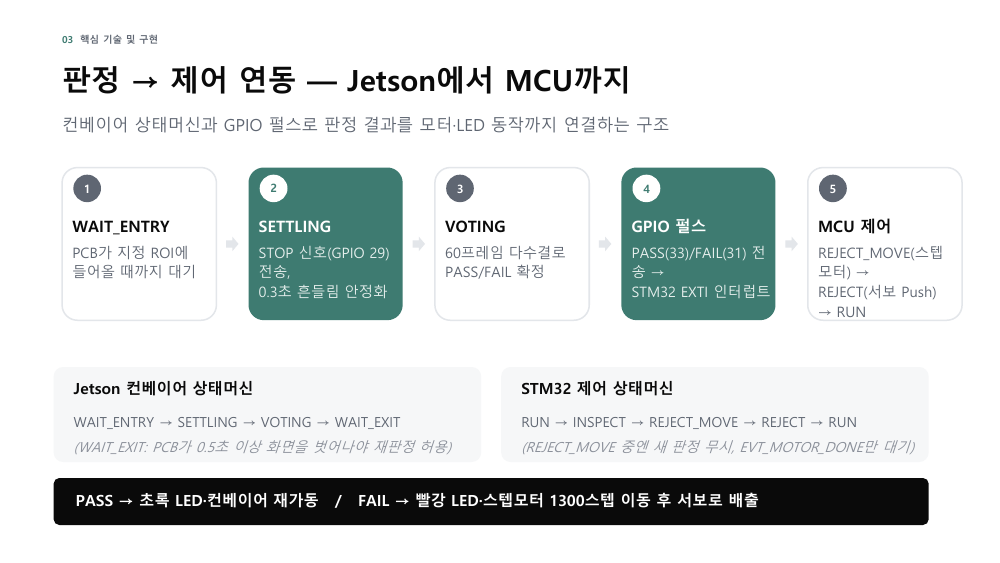
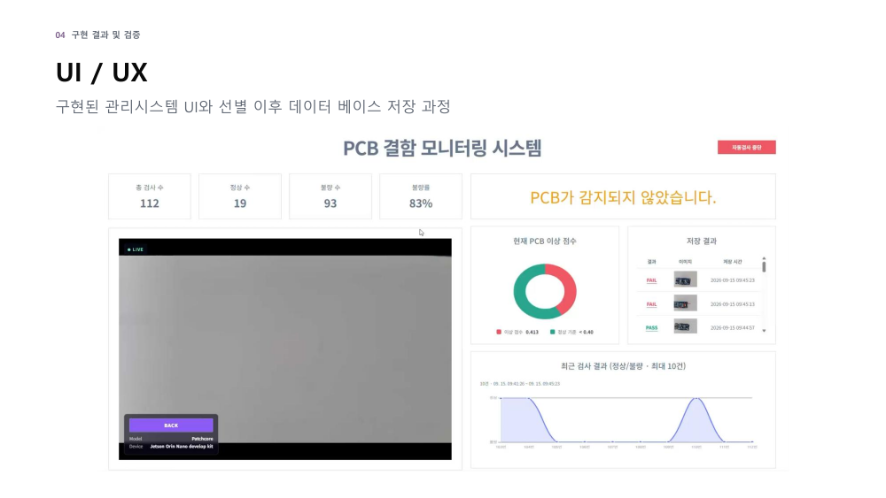

# 🛡️ BoardGuard — Vision AI 기반 PCB 불량 탐지 & 컨베이어 자동 선별 시스템

> 컨베이어 벨트 위 PCB를 카메라로 촬영해 **정상 패턴만 학습하는 비지도 이상탐지(PatchCore)** 로 양품/불량을 판정하고, 불량의 **위치·유형(12종)** 까지 찾아낸 뒤 **Jetson → STM32 GPIO 신호로 LED·스텝모터·서보모터를 제어해 불량품을 자동 배출**하는 시스템입니다.
> *AI 시스템반도체 SW개발자 2기 (대한상공회의소) · 팀 프로젝트 (4인)*

| 지표 | 결과 |
|---|---|
| Front 모델 (벨트 환경) | **AUROC 1.0 / F1 1.0** (정상 479 / 불량 50장, threshold 0.55) |
| Back 모델 (벨트 환경) | **AUROC 0.999 / F1 1.0** (정상 489 / 불량 63장, threshold 0.4) |
| 결함 유형 분류 | 12종 (resnet18 임베딩 + 1-NN) |

> 팀 저장소: [clap-min99/board_guard](https://github.com/clap-min99/board_guard) · 본 저장소는 포트폴리오용 정리본입니다.

## 🎯 문제 정의

- 육안 검사는 피로도에 따라 일관성이 떨어지고, Rule-based AOI는 규칙 밖의 결함에 취약합니다.
- 지도학습은 **불량 샘플이 극소수**여서 학습 데이터 확보가 비현실적입니다.
- → **정상 이미지만으로 학습하는 One-Class 이상탐지**를 채택했습니다.

## 🧩 시스템 아키텍처



```text
 IP 카메라 ──▶ JETSON ORIN NANO ──────────────────────────┐
              ├─ camera_thread     (프레임 수신, 자동 재연결)  │  GPIO 펄스
              ├─ inspection_worker (PatchCore TensorRT 추론)  ├──▶ STM32F411 (M4)
              └─ Flask 웹 대시보드 + SQLite (이력/이미지)       │     ├─ 스텝모터: 컨베이어/이송
                                                              │     ├─ 서보: 불량 배출
 로컬 PC 브라우저 ◀── http :5000 ─────────────────────────────┘     └─ LED(녹/적), 부저
```

| 구분 | 구성 |
|---|---|
| 하드웨어 | Jetson Orin Nano, IP 카메라, STM32F411(Nucleo-64), 스텝모터 28BYJ-48 + ULN2003, 서보 MG90S, LED ×2, 부저 |
| AI | PatchCore (anomalib), backbone resnet18 / wide_resnet50_2 비교, ONNX → TensorRT |
| SW | Python, OpenCV, Flask, SQLite(WAL), Embedded C |

## 🔬 핵심 기술

### 1. PatchCore 비지도 이상탐지
정상 패치 특징으로 Memory Bank를 구성(Coreset Sampling 0.15~0.2)하고, 정상과의 거리로 anomaly score와 결함 위치(heatmap)를 산출합니다. 앞면/뒷면 모델을 각각 학습해 사용합니다.



### 2. 결함 위치 매핑 + 12종 유형 분류
- 정상 PCB 1장 기준으로 IC, 핀, 패드 등 영역을 JSON(`*_regions.json`)으로 정의 → 결함 박스와 겹치는 영역명(`PIN_AREA` 등) 출력
- YOLO 지도학습 대신 **resnet18 임베딩 + 1-NN**으로 전환 (클래스별 표본 확보 어려움 고려)
- 결함 박스마다 따로 잘라내 분류해 **복합 결함을 동시에 구분**

`PIN_BENT` `PIN_MISSING` `SOLDER_DEFECT` `SCRATCH` `IC_MISSING` `IC_DAMAGED` `TX_DEFECT` `RX_DEFECT` `CRYSTAL_MISSING` `CRYSTAL_DAMAGED` `RC_MISSING` `MOUNTING_HOLE_DAMAGED`



### 3. 벨트 환경 대응 판정 로직
- **배경 기준 PCB 존재 검출**: 빈 벨트 사진 1장과 `absdiff`로 비교해 PCB가 없으면 AI 추론 생략
- **60프레임 다수결 판정 상태머신**: `WAIT_ENTRY → SETTLING(0.3s) → VOTING → WAIT_EXIT` — 결과를 고정하고 PCB가 완전히 빠져야 재판정 (프레임별 판정 흔들림/중복 판정 방지)
- **MCU 이벤트 큐 상태머신**: `RUN → INSPECT → REJECT_MOVE → REJECT → RUN`



### 4. Jetson ↔ STM32 연동
Jetson이 STOP / PASS / FAIL을 GPIO 펄스(10ms)로 보내면 STM32가 **EXTI 인터럽트**로 받아 이벤트 큐에 쌓고 상태머신이 처리합니다. 불량 시 빨간 LED → 스텝모터 1300스텝 이동 → 서보 Push로 배출, 정상이면 초록 LED와 함께 벨트를 재가동합니다.

### 5. 스레드 분리 웹 서비스
카메라 수신 · AI 추론 · 웹 요청을 별도 스레드로 분리해 하나가 느려져도 나머지가 영향받지 않습니다 (CUDA 컨텍스트는 추론 스레드 내부에서만 생성). 검사 이력은 SQLite(WAL)에 저장하고 대시보드에서 PASS/FAIL 이미지와 통계를 실시간 확인합니다.



## 👤 담당 역할 (김태환)

**AI 파이프라인 · 기구물**
- AI → 판정 → UI 파이프라인 연동, 카메라 지연 개선
- 결함 위치 좌표 영역 정의 (JSON)
- 컨베이어 벨트 기구물 제작 및 배경 대응 로직 구현
- 복합 결함에서 위치·유형을 구분하지 못하던 문제를 **결함 박스별 크롭 → 개별 분류**로 해결

| 팀원 | 역할 |
|---|---|
| 박수민 (팀장) | AI 모델링 — PatchCore 학습, backbone·해상도 비교, 데이터셋 구축 |
| 김태환 | AI 파이프라인 · 기구물 |
| 곽혜민 | UI · DB — 실시간 판정 UI, SQLite 연동, 이력 아카이브 |
| 이양배 | 판정 · MCU 제어 — 판정 알고리즘, Jetson–M4 GPIO, 이벤트 큐 상태머신 |

## 🛠 트러블슈팅

| 문제 | 해결 |
|---|---|
| 입력 해상도를 올리면 미세 결함 검출은 좋아지나 Jetson 메모리 한계로 TensorRT 변환 한계 | backbone과 Coreset 비율을 조정하며 성능·부하를 비교해 적정 구성 선정 |
| 여러 결함이 동시에 있을 때 위치·유형 구분 불가 | 결함 박스마다 크롭해 개별 분류 |
| Jetson GPIO 한 핀만 출력했는데 다른 핀에도 펄스 발생 → MCU 오인식 | 오실로스코프로 신호 확인, 배선·신호 간섭 점검 및 개선 |
| 실시간 판정 저장과 화면 갱신 동시 처리 | SQLite WAL 모드로 읽기/쓰기 충돌 제거 |

## ⚠️ 한계 및 향후 과제

- 저항 등 소자 단위 미세 결함은 카메라 해상도·Jetson 메모리 한계로 미구현, 다품종 PCB 검증 부족
- 향후: 조명·진동 등 실환경 안정화, 불량 원인(부품 휨·손상) 정밀 분류, 모델 경량화·고속화, 다품종 PCB 확장

## 📄 문서

[최종 결과 보고서 (PDF)](docs/final_report.pdf)
